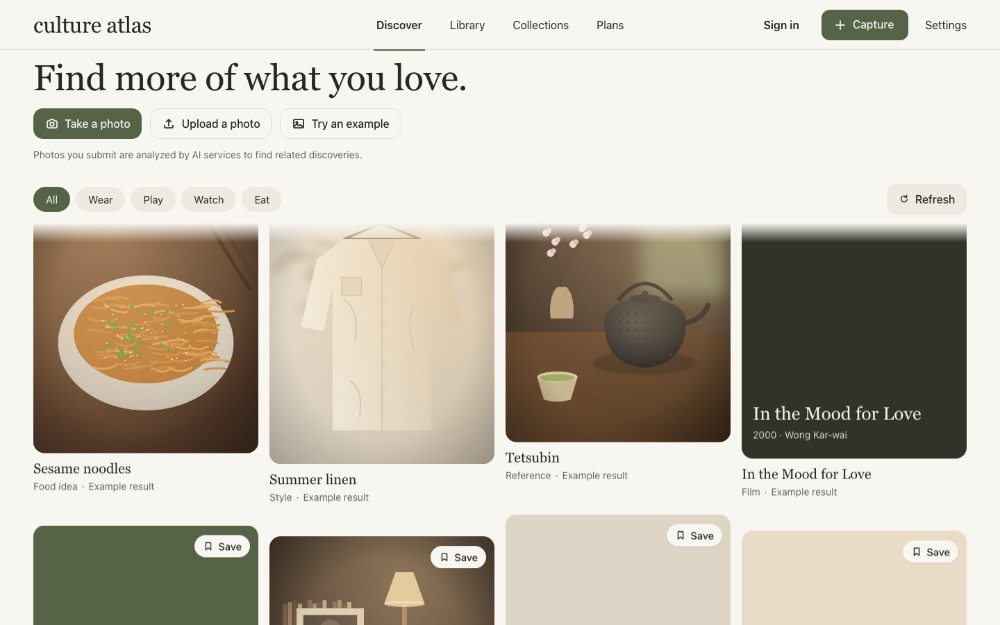
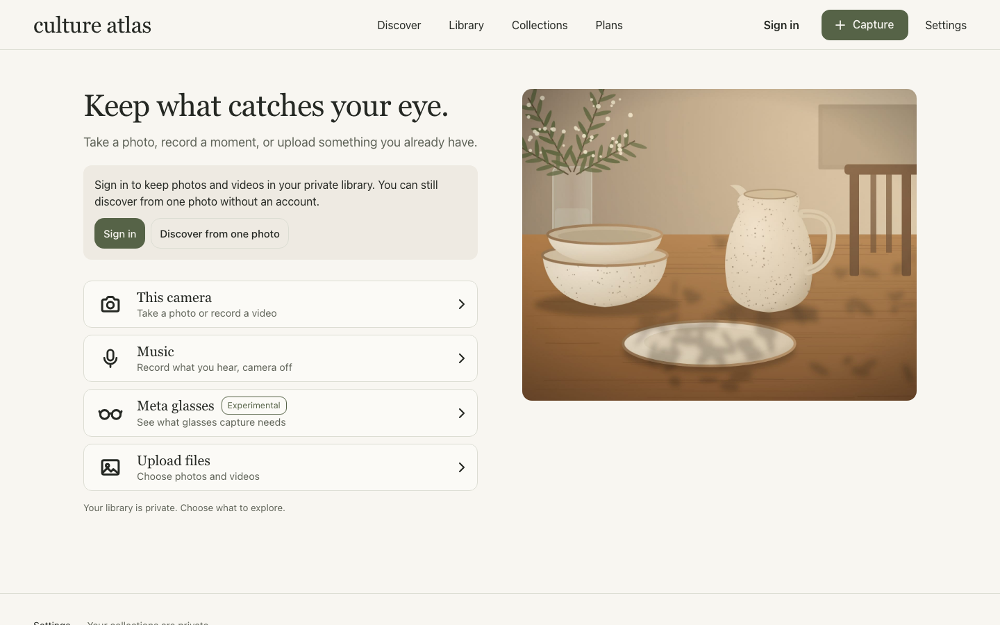

<p align="center">
  
</p>

<h1 align="center">culture atlas</h1>

<p align="center"><strong>Point at what catches your eye. Find what else you'll love.</strong></p>

<p align="center">
  <a href="https://culture-atlas.tail463884.ts.net">Live demo</a> ·
  <a href="#how-it-works">How it works</a> ·
  <a href="#run-it-yourself">Run it yourself</a> ·
  <a href="docs/agents.md">Agent tools</a> ·
  <a href="docs/README-engineering.md">Engineering guide</a> ·
  <a href="CONTRIBUTING.md">Contribute</a>
</p>

<p align="center">
  <a href="LICENSE"></a>
  
  
  
</p>

Photograph an outfit, a room, a meal, or a song playing nearby. culture atlas reads its style (the aesthetic, era, materials, palette and details), grounds that reading in Qloo's taste graph, and builds a living feed of real brands, films, music and places connected to it. Your agents can use the same library and taste through MCP.

An LLM alone can describe a photo. It can't tell you what people who love that thing also love. Qloo is what turns a description into a recommendation.

## How it works

1. **Capture.** A photo, a video, or a music recording, from the web, the iOS or Android app, or Meta glasses.
2. **Read the style.** A vision model separates what it can see from what it merely resembles, and points each claim at a region of the photo.
3. **Ground it in Qloo.** Names and style traits resolve to real Qloo entities and tags under strict matching rules. Anything Qloo doesn't confirm stays worded as "resembles" and never drives a recommendation by itself.
4. **Build suggestions.** Qloo Insights returns "more like this" and cross-category picks (Wear, Play, Watch, Eat), each with a reason that names what connected it.
5. **Keep growing.** Results join a floating feed that expands from what you save and capture.

**Nothing is invented.** Every suggestion traces to a Qloo response. Artists and films with no owned image get a typographic poster, never a generated portrait. An empty answer stays empty.



<sub>The signed-out web app, showing project-made example images. Signed-in feeds use real Qloo results.</sub>

## What's Qloo-powered

| Feature | Qloo API |
|---|---|
| Identify brands, works, places and artists in a capture | Search, with exact-name acceptance rules |
| Map style traits to the taste graph | Tags |
| "More like this" and cross-category suggestions | Insights, with explainability |
| Taste onboarding and the first feed | Insights from your picks |
| Song to related artists, films and brands | Search, then Insights |

## For agents

`/mcp` exposes library, taste, collection and capture tools to any MCP client, under scopes you grant and can revoke. See [docs/agents.md](docs/agents.md).

## Run it yourself

You need Node 22, pnpm, PostgreSQL 16, ffmpeg, and your own Qloo and Concentrate keys.

```bash
cp .env.example .env
pnpm install
pnpm db:migrate
pnpm dev
```

Production runs on your own hardware with Docker Compose: [docs/deploy.md](docs/deploy.md). Native apps: [apps/ios](apps/ios/README.md), [apps/android](apps/android/README.md).

## Status

A hackathon build, under active development.

- Photo and video readings are labeled **Experimental**: the vision models haven't passed this project's own accuracy gate, and readings can miss details.
- Song recognition uses Apple's ShazamKit, so it works in the iOS app only. Web and Android report no match.
- The live demo runs on the author's own machine through Tailscale Funnel, so its availability depends on that machine.

## Contributing and policies

- [Contributing](CONTRIBUTING.md)
- [Security](SECURITY.md)
- [Privacy](PRIVACY.md)

## License

[Apache 2.0](LICENSE).
