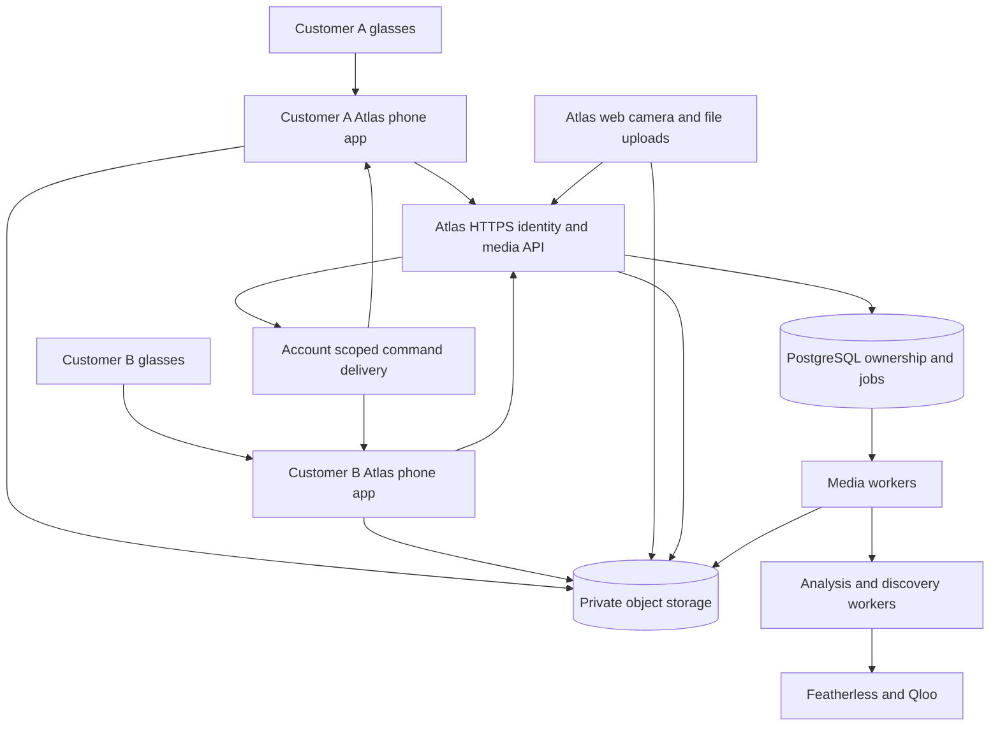

# Culture Atlas independent multi user capture scope

October 14, 2026

Culture Atlas must let unrelated customers connect their own supported Meta glasses through their own phones and accounts, capture photos and videos, upload existing media, and use discoveries without the founder's phone, computer, World Observer app, relay, home network, or bridge process. This is a consumer cloud product with native capture clients. World Observer is reusable source code, not required runtime infrastructure.

The implementation baseline is Culture Atlas main `02ec318c7e4206f67ce3ae336dc658a01fb5829d` and World Observer main `bbecdd5927d8a1173fc40672dd6b5a2a1121a275`. The Observer demo design branch adds proposed analysis behavior, not implemented capture infrastructure. This scope separates existing source, proposed architecture, and external release gates. Hardware and deployed services were not tested in this review.

## Product outcome and release gates

The target customer downloads Culture Atlas, signs in, taps Connect glasses, authorizes the integration through Meta's supported phone flow, captures media, and sees it in their own Atlas library on any signed-in device. Customers never enter relay URLs, provider API keys, bridge credentials, or developer environment variables. A single product integration supports many users; it does not reuse the founder's Meta user authorization.

Two milestones must remain distinct:

1. Independent multi-user beta: unrelated approved testers use their own hardware against hosted infrastructure, with no founder hardware running.
2. Public self-service release: eligible customers install and activate the integration through approved distribution without developer membership, Developer Mode, tester invitations, or founder intervention.

SDK stability does not establish distribution eligibility. Meta's FAQ describes DAT 1.0 as stable and rolling out from September 30, 2026. A September 28 reply in the official iOS SDK repository says DAT 1.0 does not yet resolve the MFi Product Plan/PPID obstacle for App Store submissions declaring `com.meta.ar.wearable`; TestFlight plus a release channel is its stated interim path. Public iOS availability must therefore remain an external launch dependency until the exact Atlas integration has a verified approval path. Android production authorization must be verified separately; SDK availability is not proof of public activation. [Meta FAQ](https://developers.meta.com/wearables/faq/), [official distribution response](https://github.com/facebook/meta-wearables-dat-ios/discussions/313).

“Anyone” means any eligible customer with a supported phone, glasses model, firmware, Meta AI version, and country, using an approved Atlas integration. Compatibility varies by device. Keep a product-maintained compatibility matrix and communicate unsupported cases before onboarding. Meta describes native DAT for iOS/Android and separate Display-only Web Apps; do not treat the latter as a universal camera connection for all glasses. [Meta toolkit](https://developers.meta.com/wearables/device-access-toolkit/), [Meta FAQ](https://developers.meta.com/wearables/faq/).

## Existing implementation and gaps

| Area | Existing source | Required extension |
| --- | --- | --- |
| Identity | Account/session ownership, email/password sign-in, anonymous claim, agent scopes | Recoverable consumer identity, verification/recovery, native sessions, installation enrollment and revocation |
| Photo intake | Multipart upload, byte validation, normalization, owner-scoped captures | Durable media library separated from analysis; stronger upload recovery |
| Storage | Private local/S3 objects and signed downloads | Direct/resumable uploads, streaming reads, video derivatives and cleanup |
| Jobs | PostgreSQL leases, heartbeat, retry, cancellation | Media-processing job types, per-user fairness, video cost budgets |
| Glasses integration | Atlas photo-only relay importer and local bridge | Native Atlas mobile SDK integration; no relay requirement |
| Deployment | Docker image, web/worker/Postgres/S3 blueprint | Verified hosted deployment, media worker pool, push, backups, monitoring |
| Device capture | Observer iOS Meta session/photo/HEVC recording | Extract into Atlas; implement Android; general phone cameras |
| Remote commands | Observer connect/start/stop/disconnect with poll/push | Tenant-specific devices, explicit photo/video commands, durable acknowledgements |

Atlas already has a multi-user data foundation. Its principal and owner predicates, capture authorization, and isolation tests should be extended rather than replaced. Its current auth supports browser-only accounts without email/password; those must upgrade to recoverable identity before cross-device glasses enrollment. Its deployment guide explicitly says the Docker/Render deployment had not been exercised when written. Source presence is not a deployed-service pass. [Principals](https://github.com/Vontarius-Ventures/culture-atlas/blob/02ec318/packages/domain/src/principal.ts), [auth schema](https://github.com/Vontarius-Ventures/culture-atlas/blob/02ec318/packages/domain/src/schemas/auth.ts), [deployment guide](https://github.com/Vontarius-Ventures/culture-atlas/blob/02ec318/docs/deploy.md).

## Target architecture

Phones make outbound HTTPS requests; no customer port forwarding, LAN discovery, local server, or public phone address. Presigned uploads convey narrowly scoped authority for a particular asset; they are not storage account credentials. Phone/glasses communication remains on the user's device via Meta's supported SDK. Cloud independence removes founder infrastructure, not the customer's phone or Meta authorization.

Keep one modular backend initially: Atlas web/API plus independently scalable general and media worker processes. PostgreSQL remains the durable job source; do not require a new message broker merely to support multiple users. Add event fanout infrastructure only when measured connection volume requires it. Workers must not rely on shared local disk; temporary media scratch space is disposable and bounded.

## User journeys

### First connection

1. Install Atlas iOS or Android app and sign in to a recoverable Atlas account.
2. Check app/OS/Meta AI/device compatibility; offer phone capture and uploads if glasses are unsupported.
3. Tap Connect Meta glasses. Explain the requested camera/audio access at the time it is needed.
4. Follow Meta's registration flow using the customer's Meta AI app and already paired glasses; resume Atlas through its registered callback.
5. Request supported device permissions and enumerate available devices. A singleton app configuration must not imply a singleton customer.
6. Select a device if the SDK exposes several, otherwise show the SDK's available device honestly. Do not promise simultaneous streams across multiple glasses.
7. Show a local preview and run a user-triggered test photo. Persist it locally, upload it, and confirm that it appears in this account's cloud library.
8. Explain Wi-Fi/cellular settings, audio source, retention, and whether discovery runs automatically. Recommended default: user-initiated analysis, with optional explicit auto-discover preference.

Record states separately: Atlas signed in; phone enrolled; Meta registered; glasses available; camera permission granted; stream ready; cloud reachable. “Connected” alone must not falsely imply all seven.

### Capture and upload

Provide source choices: This camera, Meta glasses, and Upload. Photo/video mode, shutter/start/stop, preview, timer, audio state and limits must be clear. Save local media before making network progress a condition of success. Show distinct states: Saved on phone, Uploading, Available in Atlas, Preparing video, Ready to explore, and Analysis unavailable.

Phone camera and glasses camera are separate adapters. Browser capture uses the local browser camera; remote glasses capture routes to a connected mobile installation. Existing files come through web file selection/drag-and-drop and native photo/file pickers. Multi-file uploads need per-file progress, failure and retry, with batch cancellation; uploading a batch must not silently analyze every file.

Do not assume the SDK exposes an archive of everything previously recorded by the glasses' hardware shutter. V1 covers media captured by Atlas through the SDK and media explicitly selected from the customer's phone/files. Historical glasses-media import and hardware-button events require separate capability verification.

### Browser-triggered glasses capture

A signed-in browser selects one of its account's enrolled phones and available glasses. The phone must have an active, user-enabled capture session. A command to a suspended or disconnected app becomes an invitation to open Atlas, or expires; it must not claim the shutter fired. Observer's push foregrounding pattern is useful here, not a guarantee that push can start a background camera.

Remote sessions are visibly armed by the customer, time-limited and revocable from the phone. Local Stop always works without the network. Starting a camera from an arbitrary dormant phone is outside the product promise. Platform background restrictions must be honored and tested per capture type; Android documents while-in-use restrictions on camera and microphone foreground-service starts. [Android lifecycle documentation](https://developer.android.com/develop/background-work/services/fgs/service-types).

### Device and account changes

On sign-out or account switch, stop capture, close the remote control session, stop command polling, revoke that session as appropriate, and lock queued media to its original account. Never upload User A's backlog with User B's new credentials. Resume only after authenticating the original owner or explicitly delete the local pending files. Switching the Meta account/device does not change Atlas media ownership automatically.

A replaced phone enrolls as a new installation; an account may have several installations. Revoke a lost phone without deleting historical media. Disconnecting glasses removes future access; deleting media and revoking cloud sessions are separate actions. Reinstall recovery must not silently bind a physical glasses identifier to a new account's old media.

## Identity and tenant isolation

Model three independent identities: Atlas account, authenticated mobile installation, and SDK-visible glasses registration/device. Meta authorization is not Atlas sign-in. Glasses names, Bluetooth addresses or SDK IDs must never authenticate a cloud user.

Recommended auth approach: a production-capable identity provider or a completed Atlas auth implementation supporting verification, account recovery and secure native authorization-code/PKCE flows where applicable. Keep the Atlas account UUID as the internal owner even if the identity provider changes. Native credentials belong in Keychain/Keystore; use rotating refresh sessions, short-lived access authority, explicit revocation, and current-device/all-device logout. Browser cookies retain CSRF protection.

Add an explicit native-device principal rather than overloading agent or sensor_bridge credentials. A device can upload its own account's assets and acknowledge commands assigned to that installation; it cannot mint other devices, select arbitrary owners, or operate another account's glasses. The server derives ownership from authentication, never from request owner_id.

Every device, upload, asset, command, derivative, processing job, event channel, and signed download must enforce account ownership. Enforce same-owner parent-child relationships through composite foreign keys or equivalent transactional checks, not UUID secrecy. Partition caches/dedupe by account. Worker authorization is reconstructed from durable job ownership, not ambient operator credentials. Service-role database access does not excuse missing owner checks. Add RLS where the deployment supports it correctly, without treating it as a substitute for application checks.

Observer's relay viewer asset query selects committed assets across its relay after viewer-scope authorization. That is a relay-level trust model, not a ready-made multi-tenant media listing. Preserve Atlas ownership semantics rather than exposing the relay wholesale. [Observer relay](https://github.com/Vontarius-Ventures/World-Observer/blob/bbecdd5/TestServer/wctp2_relay.py).

## Proposed data model

These are proposed additions, not existing tables.

| Record | Essential fields and constraints |
| --- | --- |
| mobile_installations | id, account_id, platform, app_version, session reference, last_seen, revoked_at; enrollment bound to authenticated account |
| wearable_connections | id, account_id, installation_id, opaque SDK device reference, capabilities, permission state, last_verified; no secret in display fields |
| capture_sessions | id, account_id, installation_id, source, media mode, started/stopped times, remote_arm_expiry, state |
| media_assets | id, account_id, installation_id nullable, client_capture_id, kind, origin, byte_count bigint, hash, duration, dimensions, codecs, audio_source, timestamps, status, deleted_at |
| upload_sessions | id, account_id, asset_id, staging key, multipart provider id, reserved bytes, expiration, committed object version, state |
| media_derivatives | id, account_id, asset_id, type, version, object key, checksum, dimensions/duration |
| media_segments | id, account_id, asset_id, start/end time, frame key, extraction version; required for video analysis evidence |
| device_commands | id, account_id, installation_id, capture_session_id, action, expiry, delivery/execution state, resulting asset_id |
| device_events | account_id, installation_id, sequence, event_type, payload, created_at; bounded retention and replay cursor |
| usage_reservations | account_id, resource, reservation id, amount, expiry, settled/released state |
| consent_records | account_id, purpose, policy version, accepted_at/revoked_at; no raw provider credential storage |

Use uniqueness on account + installation + client_capture_id to prevent retry duplication. Separate physical capture identity from image-hash analysis caching: two intentional shutter presses may produce identical bytes and still be separate library items. A repeated upload of the same capture should not create two items.

Retain existing captures/analyses as analysis results linked to a media asset. Backfill historical image captures as photo assets. Preserve their owner, source, existing URLs and analyses. Where originals were never retained, label them unavailable rather than synthesizing originals from derivatives. Legacy photo endpoints can adapt into the new lifecycle while clients migrate.

## Upload and processing contract

Suggested versioned operations:

| Operation | Purpose |
| --- | --- |
| POST /v1/devices/enroll | Enroll an authenticated installation |
| GET /v1/devices | Show only the current account's devices and fresh capability state |
| DELETE /v1/devices/{id} | Revoke device access and outstanding remote authority |
| POST /v1/media/uploads | Reserve quota, create asset/upload session, return scoped upload instructions |
| GET /v1/media/uploads/{id} | Resume progress and refresh allowed upload instructions |
| POST /v1/media/uploads/{id}/complete | Verify bytes/checksum/object version and commit idempotently |
| DELETE /v1/media/uploads/{id} | Abort unfinished upload and release reservations |
| GET /v1/media/{id} | Authorized metadata, processing state and permitted playback links |
| POST /v1/media/{id}/analysis | Explicit analysis with bounded options and budget |
| DELETE /v1/media/{id} | Revoke access, cancel jobs, enqueue physical purge |
| POST /v1/devices/{id}/commands | Request capture action against a live armed session |
| GET /v1/device/commands | Installation-scoped polling/streaming |
| POST /v1/device/commands/{id}/ack | Durable progress/outcome acknowledgement |

The exact route names can change during implementation; their ownership and recovery behavior cannot.

Upload state machine: created → uploading → verifying → committed; terminal aborted/expired/rejected. Media preparation is a separate state machine: queued → processing → ready/failed. Analysis state remains separate from both. Recording while offline is local state and must not fabricate cloud committed status.

Create the client capture ID before capture and persist the spool record before upload. Upload into a staging object with bounded size/content constraints and expiry. Completion checks actual object length, server-verified checksum and supported decoded format; an S3 multipart ETag is not assumed to be a SHA-256 hash. Seal or promote a verified object to an immutable committed version so a still-valid upload URL cannot overwrite analyzed bytes. Enqueue work transactionally with commit/outbox semantics. Repeat completion returns the existing committed asset.

Delete/cancel racing with upload or transcode must not resurrect content. Use tombstones and generation/fencing checks. Late staging objects are cleaned by lifecycle rules; workers recheck deletion before publishing. Native uploads resume from persisted metadata after interruption; web uploads recover while supported by browser storage/file access and explain when the user must reselect a file. Do not promise native-level background reliability in a browser.

Current Atlas reads full multipart request bytes and its storage adapter returns complete objects in memory. Add streaming/multipart operations rather than raising a photo size constant for videos. The initial SQL uploads byte_size is integer; large-media metadata should use bigint. [HTTP intake](https://github.com/Vontarius-Ventures/culture-atlas/blob/02ec318/apps/web/lib/server/http.ts), [storage](https://github.com/Vontarius-Ventures/culture-atlas/blob/02ec318/packages/providers/src/storage/types.ts), [initial schema](https://github.com/Vontarius-Ventures/culture-atlas/blob/02ec318/db/migrations/001_init.sql).

## Video and audio scope

V1 includes bounded recorded clips from phone cameras, supported glasses SDK streams, and file uploads. It includes playback, poster image, metadata, interrupted-transfer recovery, and optional discovery. Cloud live broadcasting, continuous day-long recording, and public streaming are separate later capabilities; local camera preview is required immediately.

Use a configurable qualification envelope, initially proposed as 60-second in-app clips, 250 MiB video files, and 15 MiB photos. These are product defaults for testing and cost control, not Meta limits; adjust after actual codec/device tests. Uploaded videos may use a different duration ceiling from recorded clips. Always enforce actual duration, decoded dimensions and byte size server-side.

A dedicated media worker probes containers/codecs, validates decode, generates an H.264/AAC MP4 playback derivative when appropriate, creates posters, and extracts bounded timestamped frames. HLS is optional for longer playback, not a prerequisite for short clips. Use sandboxed, resource-bounded media tools. HEVC, MOV and browser WebM inputs require qualified decoding/transcoding; renaming extensions is not conversion.

World Observer records HEVC stream frames and deliberately omits stream audio in its current configuration. Reusing it does not deliver audio recording, consumer-camera resolution, or every DAT 1.0 photo API. Implement and qualify audio routing, permissions, source labels, timestamp alignment, interruptions and muxing. If the glasses audio path cannot be supported on a device, clearly offer silent recording or an explicitly selected phone microphone; never silently claim phone audio is glasses audio. [Observer capture](https://github.com/Vontarius-Ventures/World-Observer/blob/bbecdd5/WorldObserver/Wearables/MetaWearablesService.swift), [recorder](https://github.com/Vontarius-Ventures/World-Observer/blob/bbecdd5/WorldObserver/Wearables/ClipRecorder.swift).

Atlas's existing vision interface is image-based. Initial video discovery should select a bounded set of representative frames, run existing image analysis, aggregate repeated candidates, retain timestamp evidence, and send grounded entities into existing discovery. A proposed initial budget is at most eight selected frames per short clip, with actual value tuned by quality/cost tests. This is sampled visual analysis, not full motion understanding; tell the user which portion was analyzed. Native video-model support and transcripts are optional separate adapters requiring capability verification. Preserve sample provenance and do not turn an upload or capture into a taste signal automatically.

## Durable remote commands

Commands are at-least-once deliveries with idempotent handling; do not claim exactly-once physical camera execution. Persist accepted command ID before executing. Link capture session and local asset identity so an acknowledgement lost after a shutter event can be reconciled. If the app crashes between shutter and durable save and cannot determine the outcome, return unknown/requires review rather than firing again automatically.

Command states: queued, delivered, awaiting_user, executing, succeeded, failed, expired, cancelled, unknown. Include a short expiration and session generation. Reject commands for revoked devices, a different account, stale armed sessions or unsupported capabilities. Push notifications carry a non-sensitive command reference; the app fetches authorized details. APNs/FCM delivery is a hint, not evidence of execution. Stop is safe to repeat; start references the intended session. Do not leave a delayed start command alive after its user-visible timeout.

Use installation-scoped WebSocket/SSE or long polling for foreground devices and APNs/FCM for notifications. Reconnection replays durable command state. A stale heartbeat must show unavailable, not route a new command to the founder's fallback device. Per-account event channels prevent media/status leakage across users.

## Reuse strategy and repository changes

Reuse the iOS Meta lifecycle, camera stream, recorder, local spool, background transfer patterns and corresponding tests from Observer. Extract hardware behavior from AppModel, relay pairing, operator defaults and Observer UI. Atlas should own the upload/auth adapter. Register Atlas-specific bundle/package IDs, callback scheme and Meta integration configuration. Retain only necessary SDK permissions; replace development arbitrary-load settings with production transport policy and test required SDK networking explicitly.

Suggested structure: apps/ios, apps/android; packages/domain media/device/auth additions; packages/providers multipart storage and media-processing adapters; apps/media-worker for resource-intensive preparation; apps/web source chooser/media library/device controls. A shared Swift package can host reusable Apple capture code, but there is no assumption that Swift automatically supplies Android. Use native Swift/Kotlin capture modules initially; a shared UI shell is optional and must not constrain SDK lifecycle or background transfer.

Do not port Observer's entire FastAPI/SQLite relay as the public backend. Keep the old Atlas sensor bridge as a clearly marked optional legacy import path. New users never need it. Fix Observer's fresh-UUID declaration behavior and volatile upload ID tracking in the extracted design rather than inheriting duplicate-asset retry problems. [Uploader](https://github.com/Vontarius-Ventures/World-Observer/blob/bbecdd5/WorldObserver/Library/LibraryUploader.swift).

## Hosted operations and capacity

Start with public HTTPS web/API, managed PostgreSQL with backups, private object storage, general jobs, isolated media workers, secrets management, APNs/FCM, and structured operational metrics. Provider credentials belong to the hosted product; customers do not bring the founder's personal keys. Validate service-account permissions and provider capacity for expected multi-user concurrency.

Deploy development, staging and production separately. Build signed mobile releases in CI. Execute migrations once with coordination; support old mobile clients during rolling API changes. Back up database and define object/version retention consistently. Test restore in a separate environment; a backup checkbox is not a recovery pass.

Track enrollment success, Meta registration failures by version, capture success, upload completion/retry, queue age, video preparation time, provider spend, storage growth, deletion completion, command expiry and cross-account authorization denials. Keep raw media and tokens out of logs; user opt-in diagnostic uploads are separate from routine telemetry. Feature flags must disable a broken SDK capability by platform/version without breaking ordinary uploads.

Capacity planning example, not a forecast: 1,000 daily active users × (10 photos × 3 MB + 2 clips × 30 MB) = 90 GB new originals/day, about 2.7 TB per 30 days before derivatives, backups or deletion. With all media analyzed, 10 photos + 2 clips × 8 frames = 26 image analyses/user/day, or 26,000/day. At an assumed threefold peak-to-average factor, size worker/provider concurrency from measured job duration rather than only user count. Bandwidth for playback can exceed ingestion.

Budget separately for retained bytes, uploaded bytes, media processing seconds, vision calls, Qloo requests, and concurrent jobs. Reserve quota at upload initiation; settle on verified completion and release abandoned reservations. Add per-account queue fairness so one large uploader does not starve everyone else. Pricing and infrastructure sizing require selected providers and measured workloads; this scope does not invent monthly costs.

Suggested initial service targets, subject to load/hardware qualification: metadata/command API p95 under 500 ms excluding capture/network transport; foreground command acknowledgement p95 under 2 seconds on the reference network; committed media visible in the account library within 5 seconds; at least 99% successful completion of valid uploads under the tested retry scenarios. Measure hardware capture and transcoding separately by model/clip size. No universal capture latency or background availability promise.

## Privacy and customer control

Private library by default; capture does not publish or share. Request permissions progressively and show recording/audio state. The user can disconnect glasses, revoke phones, cancel uploads, delete assets and delete their account. Delete must cover originals, thumbnails, transcodes, extracted frames, analysis associations, unfinished multipart uploads and relevant cache entries; backup retention is separately disclosed and bounded.

Authorization is checked before issuing download links. Already-issued presigned URLs can remain usable until expiration unless the underlying object/access is revoked; use short lifetimes, object deletion or an authorization gateway where immediate revocation is required. Do not promise instant signed-link revocation from a database flag alone.

Choose and document original retention, provider processing behavior, metadata stripping and optional location retention. Cloud analysis means selected media/derivatives are processed server-side and by configured providers; do not advertise end-to-end encryption that would contradict that path. Avoid exporting unrelated phone-library or Meta-account content during connection.

## Work packages and dependency order

| Package | Deliverable | Exit condition |
| --- | --- | --- |
| 0 Distribution qualification | Confirm Meta integration eligibility, beta channel, iOS MFi/public route and Android production route | Written current eligibility for exact app identifiers; unresolved public gate visible |
| 1 Identity and cloud baseline | Hosted API/DB/storage/jobs; recoverable accounts; native sessions; deployment/restore evidence | Two unrelated accounts work from different networks with founder hardware off |
| 2 Tenant media core | Assets, upload sessions, staging/commit, deletion, quotas, streaming storage | Retry/lost response/revocation/isolation tests pass |
| 3 iOS capture | Atlas app, phone capture/picker, extracted Meta lifecycle, local queue | Independent tester captures own glasses photo/video and resumes uploads |
| 4 Web media and video workers | Web camera/recorder/uploads, playback, transcodes, frame analysis | Photo/video flows pass supported browser/device matrix |
| 5 Android capture | Native Meta integration, camera/picker, queue, lifecycle tests | Independent Android tester completes equivalent journey |
| 6 Remote device control | Armed sessions, commands, acknowledgements, browser updates | A browser controls only its account's eligible active device; failures are truthful |
| 7 Public release and scale | Approved distribution, onboarding, operations, load/cost gates | Ordinary eligible users join without invites or local setup |

Packages 1–4 may progress while external distribution is pending; both iOS and Android are required for the full stated cross-platform outcome. Work can overlap once ownership/upload contracts are fixed. Do not label iOS-only beta or legacy bridge success as public completion. Continuous capture, cloud live preview/streaming, display-specific experiences and voice invocation can follow after this scope; ordinary local previews and bounded video remain in the core release.

Estimate implementation only after short hardware/distribution and upload prototypes establish unknowns. This is several workstreams—backend/media, iOS, Android, web, QA/operations—not a small endpoint transplant. Store/Meta approval elapsed time is external and must not be folded into a guaranteed engineering date.

## Acceptance tests that define independence

1. Turn off the founder's phone and computer; stop all Observer/relay/bridge processes; disable founder-specific integration credentials in the test environment. Atlas product integration credentials remain in the cloud and approved clients.
2. Two unrelated users on separate networks enroll their own phones and glasses without engineering help. Repeat with the founder signed out entirely. Production gate additionally uses users with no tester invitation or Developer Mode.
3. Each captures photos and bounded videos, uploads existing photos/videos, and sees only their own assets, jobs, devices and commands from web and mobile.
4. Attempt cross-account read, download-signing, upload completion, delete, analysis, command submission, event subscription, and command acknowledgement. All are denied without leaking metadata.
5. Disconnect networking during capture and every upload phase; crash/relaunch after declaration and after commit but before acknowledgement. Exactly one logical asset results for a retried capture; intentional second captures remain distinct.
6. Log out as A with queued media, log in as B, and prove A's files never upload into B's account. Revoke an installation during transfer and prove late completion cannot publish.
7. Deliver a command twice, deliver after expiry, crash after capture before acknowledgement, and lose connectivity during stop. No blind duplicate shutter or stale start; unknown outcomes are explicit; local Stop works.
8. Test glasses off/disconnected, missing Meta AI, denied/revoked permissions, unsupported firmware, low storage, background/lock, app termination, and competing camera use. No silent substitution to founder hardware or another customer's device.
9. Validate portrait/landscape, HEVC/MOV/WebM inputs, malformed files, oversize/duration rejection, audio availability/sync, and timestamped frame evidence on the supported matrix.
10. Delete during transcode/analysis/upload; confirm jobs cannot republish assets and lifecycle cleanup removes abandoned storage. Revoke access to derivatives and event streams.
11. Load multiple accounts concurrently, verify fair queues and bounded cost, simulate provider outage, and restore database/media references from backup in staging.
12. Complete public Meta authorization and store approval with actual Atlas app identifiers. An approved beta proves technical independence; it does not satisfy public self-service distribution.

## Decisions to resolve before implementation freezes

Recommended defaults are cloud-hosted infrastructure, native iOS/Android capture, private libraries, account-required glasses enrollment, explicit analysis, bounded clips, and SDK capability-based quality. Remaining product decisions are maximum recording/upload duration, whether audio is mandatory for first release, original retention/storage allowance, initial regions/device list, whether remote browser capture is launch-critical, and whether the beta can launch while public iOS distribution remains blocked. None changes the central requirement that every customer uses their own hardware and identity.

The implementation must not depend on a customer running a relay, the founder approving each connection by hand in the finished public product, a developer-mode bypass, or broad access to a shared media pool.
