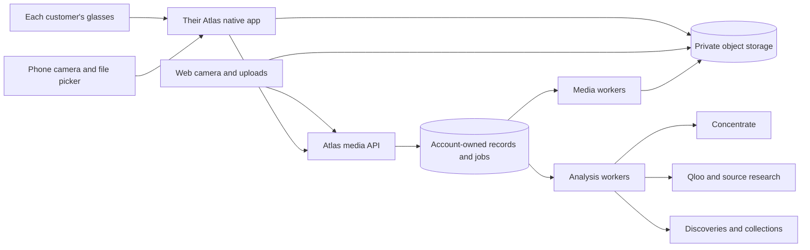

# Product and architecture

> Audio scope is extended by [amendment2.3](AUDIO-AND-MULTIMODAL.md): standalone audio, Music Mode, soundtrack/evidence analysis, provider qualification, new permissions and safe sharing migration. This amendment takes precedence for audio; other behavior is unchanged.

## Required outcome

A customer signs into culture atlas, connects their own compatible glasses on their own phone, captures a photo/video, sees it in their private library across devices, and chooses what to explore. Web/phone camera capture and file uploads work independently of glasses availability. No relay setup, developer credentials, terminal, customer server, or founder authorization is part of normal public onboarding.

The Meta connection is experimental, not deferred: native capture, permissions, retries, diagnostics, disconnect, local recording and cloud uploads are implementation requirements. Label the entry, setup and connected screens Experimental. Unsupported users receive a clear unavailable state and working camera/upload alternatives. Never show simulated pairing as a real connection.

Concentrate backs image understanding, bounded video-frame interpretation, source-claim extraction and plan composition. Qloo remains the cultural-discovery source; Concentrate is not a replacement for Qloo, storage, identity or authoritative reference research. Preserve grounded references, uncertainty and explicit taste updates.

## Scope

| Capability | Required v2 behavior |
| --- | --- |
| Accounts | Recoverable account login across web/iOS/Android; device enrollment/revocation; explicit account switching |
| Library | Account-private photos/videos independent of whether analysis exists; filters, selection, deletion and collection saving |
| Camera | Live preview, photo/video modes, front/back selection when supported, explicit microphone state |
| Uploads | Web file selection/drop and native photo/file pickers; multi-file progress and partial recovery |
| Glasses | Each user's own native Meta SDK registration; camera permission, availability, photo and bounded video capture; experimental |
| Remote capture | Browser requests to the same account's explicitly armed phone session; expiry, acknowledgement and local stop |
| Video | Validation, poster, playable derivative, representative frames, explicit sampled-frame discovery |
| Cloud | Hosted API, PostgreSQL, private storage, durable jobs, media workers and push; no local operator dependency |
| Models | Dedicated Concentrate adapter, qualified models/routes, validated structured responses, cost and privacy controls |
| Continuity | Offline local native capture, persisted upload identity, cancellation, device revocation and deletion fencing |

Excluded from v2: continuous all-day recording, cloud live broadcast, automatic archival of the glasses' hardware-shutter history, public media sharing, team accounts, background remote camera activation guarantees, face identification, and automatic taste updates from capture/upload. These exclusions do not remove ordinary local preview or short video capture.

## Product defaults

These are Atlas defaults, not claims about SDK limits. Server-issued capability policy is authoritative and versioned. Lower device/provider limits win.

| Setting | Default |
| --- | --- |
| Photo input | JPEG/PNG/WebP; HEIC/HEIF only with qualified decoder; 15 MiB and 40 megapixels maximum |
| Native captured clip | 60 seconds maximum, with visible countdown for last 10 seconds |
| Uploaded video | 120 seconds and 250 MiB maximum; MP4/MOV/WebM containers with qualified codec combinations |
| Batch upload | Up to 20 files, 2 concurrent transfers; independent per-file results |
| Native auto upload | On for explicit Atlas captures; Wi-Fi only by default; explicit cellular override |
| Automatic analysis | Off; saving media never silently initiates inference |
| Audio | Phone/browser video requests mic when enabled; glasses audio experimental and capability-gated; default off for glasses |
| Video analysis | At most 8 representative frames; sample whole duration, retain timestamps; user can select one moment instead |
| Remote arm | Off; explicit 10-minute session; no automatic re-arm after reconnect/sign-in |
| Command expiry | 30 seconds; unknown delivery is not success |
| Upload session lifetime | 24 hours; signed part instructions expire after 15 minutes and are refreshable while session remains valid |
| Media access URLs | 5-minute download/playback authorization; refresh after owner check |
| Initial account storage | 5 GiB logical retained assets; quota enforced before upload; operator-configurable |
| Analysis allowance | 50 user-requested photo/video analyses per UTC day; underlying frame/provider limits enforced separately |
| Retention | Account library persists until deletion or disclosed quota policy; no silent age-based removal |
| Deletion | Hide/revoke immediately; physical primary objects within 24 hours; backup lifecycle documented, target 30 days |

Only authenticated recoverable accounts can enroll devices or retain v2 library media. Existing anonymous discovery remains a bounded photo-only preview flow; converting to an account preserves explicitly claimed records. If HEIC cannot decode, offer conversion guidance without falsely accepting it. Do not silently increase limits because credits are available.

## Navigation

Add Library between Discover and Collections. Desktop: wordmark, Discover, Library, Collections, Plans, Capture, Settings. Mobile bottom navigation: Discover, Library, Collections, Plans; Capture is a distinct action above the bar. Settings is reachable from header; Devices lives there. Camera and media detail use Back and no bottom bar. Collections remain curated cultural groups; Library is owned source media, not another collection name.

Routes: /library, /library/media/{id}, /capture, /uploads, /settings/devices, /settings/devices/{id}; existing /captures/{id} analysis routes continue to work and link to their source asset. Capture is a three-way chooser: This camera, Meta glasses (Experimental), Upload files. On a browser, Meta glasses routes to connected phone selection, or installation/connect guidance; do not pretend browser Bluetooth is the integration.

## Components and implementation ownership

Keep Atlas domain ownership/auth/jobs/providers. Extract Observer's Swift capture logic into a focused reusable Apple module, removing AppModel/relay/operator assumptions. Build a Kotlin capture adapter for Android using its SDK. Share server contracts and fixture expectations, not UI runtime or Swift source across platforms. A shared UI framework is optional only if it preserves native SDK lifecycle and file-backed background transfers.

| Area | Required files/modules |
| --- | --- |
| apps/web | Library, CaptureSource, CameraCapture, UploadQueue, MediaDetail, Devices, remote status |
| apps/ios | Account session, device enrollment, native phone/Meta adapters, local media store, background uploader |
| apps/android | Equivalent native adapters, permission/lifecycle handling and persistent background uploads |
| packages/domain | media, upload-sessions, devices, remote-capture, analysis-media, quotas and owner checks |
| packages/providers | Concentrate transport, provider-neutral structured runner, multipart/streaming storage adapters |
| apps/media-worker | Resource-bounded probing, transcoding, posters, frames and cleanup |
| apps/worker | Existing discovery/plan jobs plus asset-analysis orchestration |

No customer can use a global default phone. Backend routing always requires account + installation + active capture session. Keep the legacy Sensor bridge optional for historical integration; never use it to satisfy independent-capture acceptance.

## Identity model

Atlas account owns data. Mobile installation is an authenticated client of that account. Meta registration authorizes local hardware access and does not authenticate Atlas. Glasses IDs and display names are not cloud credentials. One account can enroll multiple installations, each with capability-based available devices. Do not promise simultaneous glasses connections that the SDK does not expose.

Use a production-capable identity flow supporting native sessions, verification, recovery, revocation and secure refresh rotation. Preserve internal Atlas account UUIDs if introducing managed identity. Do not ship passwordless browser-only demo accounts as recoverable multi-device identities. Store native secrets in Keychain/Keystore. Session callbacks must validate state/nonce and fixed redirect destinations; registration callbacks do not accept arbitrary account bindings.

On sign-out/account switch: end capture and remote arm; stop polling; lock pending media to its original account; never reuse new credentials to upload old-account bytes. Reauthentication of the original account can resume, or the user can delete local pending data. Removing a phone stops its future authority but retains past media unless separately deleted.

## Media and discovery architecture

Media persistence, preparation and analysis are independent. The user can keep/play a video while model availability is down. Cloud-side models receive normalized derivatives or selected frames, not unbounded originals. All model-produced text is untrusted and schema-validated; visible text in media cannot change system instructions or invoke tools.

A video analysis records exact frame timestamps and extraction version. Recommendations cite observations with their source frame/segment. Aggregate duplicate candidates without inventing motion or events outside sampled frames. Display “We explored selected moments, not every frame.” No native-video endpoint is assumed for Concentrate.

## Experimental release policy

Feature inclusion is mandatory; public activation is conditional. Server effective availability is the intersection of build support, app release channel eligibility, account/cohort rollout, OS/device compatibility, local permission/readiness and kill switch. Client flags cannot grant access. Per-platform disabled states preserve all existing media and non-glasses features.

Build and test a real experimental SDK-enabled iOS/Android artifact. Public-store artifacts must contain/activate the SDK only where permitted. If mandatory SDK declarations block approval, create the permitted separate distribution/build variant while retaining experimental source/UI/contracts in the repository; do not remove mandatory declarations to evade review. A runtime Experimental badge alone cannot satisfy store restrictions.

Meta's September 28 SDK-repository response says DAT 1.0 did not resolve iOS MFi/PPID publishing and identifies TestFlight plus release channel for testers. Verify current eligibility for Atlas's exact identifiers before public shipment; do not infer Android approval from iOS or SDK availability. [Distribution evidence](https://github.com/facebook/meta-wearables-dat-ios/discussions/313).

## Deployment and operational policy

Use public HTTPS API, managed PostgreSQL, private object storage, general workers, media workers, APNs/FCM, secrets management and CI-built native apps. Phones make outbound connections; no local relay or user port forwarding. Server objects and jobs survive process restarts; local worker scratch is disposable. Development/staging/production have separate databases, keys, buckets and app configuration.

Deploy backward-compatible schema additions before clients. APIs publish contract version and capabilities; support the previous released mobile contract during rollout. Pin processing/model versions per job. Feature rollback stops new work without losing completed library items. Restore database backups and object references in a staging exercise before release.

Track enrollment, camera success by device/OS, upload commit rate, oldest job age, media preparation latency, remote outcomes, credit/budget failures, deletion completion and per-account resource use. Log IDs/statuses and timings, not photos, frame payloads, transcripts, secrets or full model prompts. No founder-only inspector grants confer access to other accounts.

## Agent and sharing extension

The required agent setup/preferences API, scoped capture interaction and collection sharing are defined in [Agent access and collection sharing](AGENTS-AND-SHARING.md). Its new explicit scopes extend existing grants without increasing old token privileges. Sharing is private by default and independent of agent/device authorization. These features are included in the build order and screen contract.
