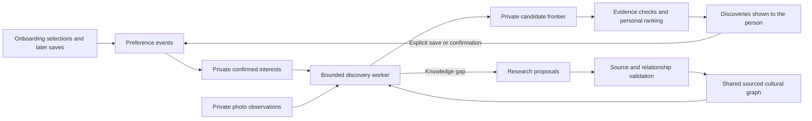

# Culture Atlas: personal relationship graph and evidence backend

Design proposal · October 27, 2026 · Research and architecture, not implemented or benchmark-qualified

## 1. Decision

Build a shared, sourced cultural knowledge graph with a private personal overlay for each account. Populate the overlay from explicit onboarding selections and subsequent saves, confirmations, and preference edits. Run bounded background discovery from those signals. Keep discovered possibilities distinct from confirmed preferences.

Every person gets their own logical graph. This does not require a separate database or a duplicate copy of cultural knowledge per person. Shared cultural entities have canonical IDs; private preference edges, experiences, contexts, and discovery frontiers belong to the account. Private user material is never promoted into the shared graph merely because an agent extracted it.

The product should be able to explain two different things independently:

1. **Why this is connected:** evidence establishing a relationship between cultural entities or a photo feature and a candidate.
2. **Why it is relevant to me:** the person's actual selections and the permitted inference path connecting them to that candidate.

A strong personal preference cannot compensate for an unsupported cultural relationship. A sourced cultural relationship does not establish that a person likes its endpoint.

## 2. What Atlas already has

Audit reference: `factory6/integration`, commit `7188184d8ec8b7482652799d97608351188c377a`. This is the newer unmerged style work, not a claim about deployed behavior.

- Onboarding picks become ordinary explicit saves with `source: onboarding`; removing a pick respects saves supported by other picks. [onboarding.ts](https://github.com/Vontarius-Ventures/culture-atlas/blob/7188184d8ec8b7482652799d97608351188c377a/packages/domain/src/services/onboarding.ts)
- Preference actions record events, advance taste revisions, and rebuild the profile. Save/remove/hide/unhide already have defined behavior. [preferences.ts](https://github.com/Vontarius-Ventures/culture-atlas/blob/7188184d8ec8b7482652799d97608351188c377a/packages/domain/src/services/preferences.ts)
- Taste is derived from current explicit preferences. Uploading, viewing, and opening do not change taste. Collection-limited agents receive a scoped taste calculation. [taste.ts](https://github.com/Vontarius-Ventures/culture-atlas/blob/7188184d8ec8b7482652799d97608351188c377a/packages/domain/src/services/taste.ts)
- The current fold gives items full weight and their anchors smaller weights, deduplicates saves, and treats hides as item-specific. It is a useful predecessor to a graph projection, but not a rich relationship model. [taste-fold.ts](https://github.com/Vontarius-Ventures/culture-atlas/blob/7188184d8ec8b7482652799d97608351188c377a/packages/domain/src/library/taste-fold.ts)
- Taste seeding already provides budgeted Qloo discovery from explicit selections, with provider provenance and distinct wording for picks versus feed-derived signals. [taste-seed.ts](https://github.com/Vontarius-Ventures/culture-atlas/blob/7188184d8ec8b7482652799d97608351188c377a/packages/domain/src/pipeline/taste-seed.ts)
- Cultural research already stores references, claims, and sources. Extend these records instead of creating an unrelated second research library. [research.ts](https://github.com/Vontarius-Ventures/culture-atlas/blob/fb8a10ad774cd9135f284f96531b19ef08fc029e/packages/domain/src/compiler/research.ts)

Preserve these semantics during migration. In particular, an automatic graph-expansion job must not call the preference-save path on the user's behalf.

## 3. Four graph layers

| Layer | Contents | Ownership | How it grows |
| --- | --- | --- | --- |
| Cultural knowledge | Entities, concepts, works, creators, traditions, attributes, sourced relationships | Shared, subject to source/provider usage rights | Source ingestion, entity resolution, validated research |
| Personal preferences | Confirmed interests, contextual preferences, explicit exclusions, tentative derived affinities | Private per account | Explicit selections and controlled derivation |
| Personal experiences | Captures, selected subjects, observations, corrections, supporting analysis versions | Private per account | User-authorized intake and analysis |
| Discovery frontier | Possible next entities/topics, evidence paths, coverage gaps, research jobs, impressions | Private per account | Bounded background exploration; expiry and pruning |

The frontier may contain thousands of possibilities without treating any as something the user likes. A frontier is a work queue and recommendation pool, not a preference history.



## 4. Node types and identity

**Shared nodes:** `Entity` (artist, brand, venue, creator), `Work` (film, book, recording, artwork), `Concept` (aesthetic, technique, movement), `Attribute` (form, motif, visible feature), `SourceDocument`, and `EvidenceSpan`.

**Private nodes:** `Account`, `PreferenceContext`, `PreferenceEvent`, `Capture`, `Subject`, `Observation`, `Interpretation`, `Candidate`, and `RecommendationDecision`.

An account's interest in an entity is generally an edge rather than another copy of the entity. A context is an explicit collection/project or selected intent, such as home renovation, clothes, or a trip. Do not infer life circumstances from photos.

Use Atlas-owned UUIDs as primary identity. Keep provider IDs in a separate namespace mapping: `(provider, external_id) -> atlas_entity_id`. Names are aliases, not identity. Record ambiguous matches and proposed merges separately. Do not merge concepts with the same spelling across domains: architectural minimalism and musical minimalism are distinct nodes. A relationship between them requires its own evidence.

Separate a real-world cultural entity from its provider-specific listing and a user's saved discovery card. Several listings/cards can point to one entity; ownership of a card does not make the public entity private or expose the user's saved status.

## 5. Edges are typed assertions with support

Avoid a universal `RELATED_TO` edge as the basis of a factual explanation. It can be a retrieval hint, but it is too vague to establish relevance.

| Predicate | Example shape | Meaning and limitation |
| --- | --- | --- |
| `CREATED_BY` | work → creator | Sourced authorship |
| `ABOUT` | documentary → movement | Its subject matter, established from a source |
| `USES_TECHNIQUE` | work/object → technique | Documented technique, not inferred origin |
| `HAS_ATTRIBUTE` | item → feature | Candidate-side evidence; specify item, collection, or brand scope |
| `ASSOCIATED_WITH` | entity → movement | Only with a defined relationship subtype and evidence |
| `VISUALLY_RESEMBLES` | observed subject → concept/item | Qualified comparison supported by observations; not identity |
| `AFFINITY_WITH` | entity → entity | Provider audience association; never restated as visual similarity |
| `SELECTED` | account → entity/concept | Direct user choice, with event provenance |
| `PREFERS_FEATURE` | account/context → feature | Explicit or derived; distinguish the two |
| `EXCLUDES` | account/context → item/topic | Explicit scope; item hide does not exclude an entire culture |
| `SUGGESTED` | account/context → candidate | Candidate only; no preference endorsement |

Model an assertion as its own record so it can have multiple supporting and opposing evidence links. Suggested assertion fields:

```text
id, subject_id, predicate, object_id
scope: shared | account_private
owner_account_id, context_id (when private)
relation_subtype, domain, evidence_scope: item | collection | brand | concept
status: proposed | validated | disputed | superseded | retracted
valid_from, valid_until          # when the assertion applies
recorded_at, superseded_at       # when Atlas knew/changed it
extractor_version, validator_version, source_revision
```

Separate evidence records contain source URL/provider query ID, exact passage or structured attribute, locator, retrieval date, document hash, license/retention metadata, and support/refutation role. Private visual evidence additionally includes capture/analysis/observation IDs, frame time or region where applicable, and access scope.

Maintain separate measures for identity resolution, observation support, relation support, and preference strength. A single `confidence: 0.92` hides which part is uncertain. Model-generated confidence is not a calibrated probability or proof.

Multiple mirrored pages or repeated model extractions are not independent supporting sources. Keep source-family and derivation dependencies so repetition cannot inflate confidence.

## 6. Personal preference structure

Each preference edge carries:

```text
owner_account_id, target_id, optional context_id
origin: explicit_selection | explicit_statement | derived
state: confirmed | tentative | suppressed | revoked
support_event_ids, supporting_assertion_ids
positive_support, explicit_negative_support
first_confirmed_at, last_confirmed_at
policy_version, taste_revision
```

Confirmed interests remain until removed or changed. Recency can influence recommendation ranking without silently deleting a person's declared interest. Tentative affinities can decay or expire. Temporary contexts may expire independently of global preferences.

Do not treat unsave as dislike. It withdraws that save's support. Do not treat an item hide as dislike of every attribute on the item. Feature-level exclusions require an explicit feature-level action. Keep incompatible or contextual preferences side by side when appropriate: liking both maximalist art and minimalist furniture is not a contradiction.

A save can strengthen a specific feature cautiously, but one save does not endorse all metadata attached to the saved object. Preserve the selected focus when available. Ask a lightweight clarification only when it would materially improve learning, for example, “Was it the shape, the colors, or the artist?”

Initial scoring should be transparent and versioned. Start from the existing explicit-save fold; use bounded feature contributions from independent selections, lower weights for derived affinities, and capped propagation. Numerical weights and decay constants are tuning parameters, not established scientific values. Do not multiply uncalibrated confidence values and present the result as a probability.

## 7. Lifecycle: onboarding to continuous growth

1. **Onboarding selection:** resolve the existing server-validated pick to canonical entities/concepts. Save it through the existing preference transaction. Record the event, taste revision, and outbox job atomically.
2. **Projection:** build confirmed preference edges. Preserve the original pick grouping so one image representing several provider tags does not count as several independent endorsements.
3. **Seed discovery:** traverse a small approved neighborhood and reuse existing Qloo/provider adapters. Create candidates with complete evidence paths. The user can receive a first feed before deeper research finishes.
4. **Explicit feedback:** save/confirm strengthens support; remove withdraws support; hide excludes that item. Recompute affected edges rather than incrementing an irreversible counter.
5. **Automatic exploration:** jobs run after meaningful taste changes and periodic stale-frontier checks. Research gaps around active interests, verify proposed relationships, and refresh candidates within account/provider/global budgets. This is proposed product behavior, not an automation created by this document.
6. **Correction or retraction:** invalidate dependent interpretations, candidates, reasons, and derived preferences. Preserve other independent support. Explicit interest in an item remains unless the person withdraws it; a corrected attribute may disappear without undoing that item save.
7. **Forget/reset:** purge targeted private events/evidence/embeddings and rebuild projections. Append-oriented event history is not an excuse to retain content after deletion.

Every job is bounded by maximum traversals, candidate count, provider calls, spend, elapsed time, and refresh interval. Deduplicate by account, taste revision, graph revision, policy version, and query intent. Refreshing the same cached result must not create new supporting evidence.

Automatic discovery must never promote a displayed, fetched, or agent-recommended item to a confirmed interest. Otherwise the system can become more certain about its own guesses without learning anything from the person.

## 8. Retrieval and recommendation contracts

Use distinct intents: `similar_form`, `about_subject`, `historical_connection`, `personal_affinity`, and `explore_adjacent`. Each intent has an allowed edge-path grammar.

For example, a permitted path might be:

```text
user --SELECTED--> concept
documentary --ABOUT--> concept
```

This supports “A documentary about a topic you selected.” It does not support “This film has the same visual style as your photo.”

A photo path may be:

```text
private observation --SUPPORTS--> qualified interpretation
candidate --HAS_ATTRIBUTE--> matching feature
```

The candidate needs independent candidate-side evidence. A brand carrying a material tag is not proof that every product from that brand matches the pictured object.

Pipeline:

1. Authorize account and resource/context scope.
2. Resolve active preferences and, when applicable, current photo evidence.
3. Generate candidates through approved graph paths, provider retrieval, and semantic search.
4. Require intent-specific evidence and exclude revoked, stale, ambiguous, or incompatible candidates.
5. Apply explicit constraints before ranking.
6. Rank eligible candidates using personal relevance, source/relationship quality, specificity, novelty, repetition penalties, and contextual fit.
7. Diversify within the eligible pool; exploration must not bypass admission checks.
8. Store a recommendation decision and a minimal authorized proof path.
9. Render a faithful reason from that proof. Language generation may phrase an established relation but cannot invent one.

Embeddings help retrieve possibilities; they do not establish factual edges. Multi-hop paths are not automatically transitive: A relates to B and B relates to C does not prove A shares C's style. Start with shallow bounded traversal and expand only for reviewed path templates.

Keep photo usefulness and personal relevance as separate outputs. A film may be personally appealing while having no useful connection to the photographed statue. Display it in the appropriate discovery context rather than using personal taste to conceal a failed photo match.

Record exposures separately for repetition control and evaluation. No click/view-based preference learning in the initial migration; introducing it later would be a deliberate product change with its own controls and evaluation.

## 9. Agent design

Use bounded workers with narrow tools rather than a single unconstrained agent writing facts directly:

| Worker | Reads | Writes |
| --- | --- | --- |
| Preference projector | Authorized current saves, corrections, events | Rebuildable personal edges |
| Entity resolver | Provider identities, aliases, typed candidates | Resolution proposals; validated mappings where deterministic |
| Research worker | Shared research gaps and approved sources | Proposed assertions and evidence |
| Validator | Source evidence, predicate rules, private observation links when authorized | Validation/dispute decisions |
| Discovery planner | Scoped personal graph and eligible shared facts | Candidate frontier |
| Ranker/explainer | Eligible candidates and scoped proof paths | Recommendation decisions and reasons |

Proposed internal tools: `read_interest_context`, `lookup_entities`, `find_evidence_paths`, `propose_assertion`, `attach_source_evidence`, `enqueue_research`, `rank_candidates`, and `explain_decision`. Authenticated service code injects account identity; an LLM-supplied account ID is never authority. Tools validate typed inputs, resource grants, budgets, and current revisions. Arbitrary SQL/Cypher and unrestricted graph mutation are unnecessary agent capabilities.

LLMs can extract claims and suggest relationships. Promotion to the trusted graph requires evidence checks specific to the predicate. High-impact identity merges and disputed historical relationships can enter a review queue. Model agreement alone is not validation.

## 10. Storage and isolation

Recommended first implementation: existing Atlas PostgreSQL as authority, normalized graph assertions/support tables, optional pgvector embeddings, and existing job infrastructure. Graph edges are a data model; introducing a separate graph server is not required to begin.

Proposed additions (reusing existing records where equivalent):

| Table/concept | Purpose |
| --- | --- |
| `knowledge_nodes`, `external_identifiers`, `entity_aliases` | Canonical shared identity and concept sense |
| `relationship_assertions`, `assertion_support` | Typed claims, revisions, support and refutations |
| `source_documents`, `evidence_spans` | Extend existing sources/claims with claim-level evidence |
| `private_observations`, `interpretation_support` | Private capture evidence and dependencies |
| `personal_graph_edges`, `personal_edge_support` | Rebuildable preference projection |
| existing `preference_events` plus graph outbox | Authoritative actions and reliable projection work |
| `discovery_frontier`, `recommendation_proofs`, `exposures` | Candidate state, reasons, and repetition history |

Private records and private embeddings carry account scope. Composite ownership constraints prevent edges from linking one account's private nodes to another's. Preserve the existing principal, owner-predicate, and selected-collection rules; add database row security as defense in depth after checking the actual service roles. PostgreSQL owners and bypass roles can bypass RLS, so enabling it alone is not sufficient. [PostgreSQL RLS](https://www.postgresql.org/docs/current/ddl-rowsecurity.html)

Use a transactional outbox for projection jobs; assume at-least-once delivery and require idempotency. Cache keys include owner, grants/context, taste revision, graph revision, and policy version. If a graph backend is added later, it is a rebuildable projection with measured synchronization lag. Recheck authorization, explicit exclusions, and revoked support against authoritative state before returning results.

Collection-limited agents must not receive a global inferred profile or an explanation derived from ungranted saves. Build their preference projection from authorized support only. A public shared node does not make its private connecting edges public.

pgvector offers exact/approximate vector search inside PostgreSQL. Its documentation notes that approximate-index filtering can reduce returned results; measure filtered recall and use suitable indexes/partitioning or exact scoped search for small private sets. Filtering must enforce access control inside the authorized data path, not by returning unauthorized candidates for later client filtering. [pgvector](https://github.com/pgvector/pgvector)

Provider data rights are separate from software licenses. Do not assume Qloo responses or third-party images can be retained indefinitely, redistributed in a shared graph, or used to train models. Store allowed provenance and obey source-specific retention/display terms.

## 11. Framework choice

See [the independently researched framework comparison](FRAMEWORKS.md) for source links, current license checks, and deployment limitations.

Proposed decision: implement the Atlas domain schema and preference projector in PostgreSQL first; run Graphiti as an optional evaluation of temporal extraction and graph retrieval, behind Atlas-owned authorization. Keep Cognee as the alternative for ingestion orchestration and LightRAG as a possible shared-research retrieval component. Neither a memory framework nor a graph database replaces the evidence admission and personal recommendation policy above.

Do not require two graph databases in the first implementation. If Graphiti's selected release/backend cannot meet the projection, ownership, source-link, or deletion contract, keep it in shadow evaluation or use its design patterns without making it a runtime dependency.

## 12. Evaluation and delivery sequence

**Phase A — preference graph:** extend current onboarding/save/remove/hide/correction behavior into a private graph projection, preserving public API compatibility and undo semantics. Backfill from current saves with accurate origin metadata; do not manufacture missing event timestamps or historical intent. Compare the new projection to current taste outputs before switching ranking.

**Phase B — evidence pilot:** build a small sourced cultural neighborhood for art, sculpture, and interiors. On the failed examples, first determine whether useful candidates exist. Compare curated retrieval, current Atlas retrieval, and graph-assisted retrieval so missing content can be distinguished from ranking failure.

**Phase C — bounded autonomous expansion:** enable per-user frontier refresh and research-gap jobs. Measure marginal useful discoveries per provider dollar and per job, not graph size. Add expiration and pruning so stale frontier nodes do not grow forever.

**Phase D — framework bakeoff:** feed the same corpus, typed events, corrections, deletions, and adversarial cases through the SQL baseline, Graphiti adapter, and at most one alternative. Pin releases and licenses. Measure evidence preservation, exact provenance retrieval, temporal corrections, account isolation, deletion behavior, latency, and costs. No automatic pass from a framework's advertised benchmarks.

Required checks:

- Onboarding creates only the selected interests; a bundled pick does not multiply its evidence.
- Repeated jobs, mirrored sources, duplicated saves, or extra collection membership do not inflate support.
- Recommendations do not endorse themselves; photo analysis alone never changes taste.
- A save/remove/save sequence and undo rebuild deterministically.
- Explicit exclusions beat ranking and exploration; removing an item does not become culture-wide dislike.
- Contextual preferences stay contextual; users can correct or forget an inferred interest.
- Same-word, different-sense concepts stay separate; candidate-side evidence is mandatory across all retrieval routes.
- Retracted photo evidence removes dependent reasons/candidates without erasing independent support.
- Account A cannot read B's nodes, embeddings, suggestions, paths, job outputs, or cache entries; selected-collection agents cannot infer global interests.
- Deletion reaches graph projections, vectors, caches, job payloads and retained private evidence according to the deletion policy.

Quality metrics: useful-photo coverage, useful-personal-discovery coverage, unsupported-reason rate, duplicate/echo rate, contextual fit, coverage by domain, fresh-holdout transfer, and source freshness. Report latency, calls, unreconciled reservations, and actual billing separately. Fixing a misleading reason without increasing useful discoveries is a precision repair, not proof that discovery has improved.

Historical failed photos are tuning and regression data. Final qualification needs a fresh holdout, reviewers who inspect relevant candidate material, and criteria frozen before candidate output review. This proposal does not claim to reproduce the separate 7/24 benchmark or satisfy its five gates.

## 13. Acceptance outcome

A person selects interests during onboarding, immediately receives a private, inspectable interest graph and initial discoveries, and continues to refine it through ordinary explicit actions. Background workers add sourced knowledge and possible next discoveries. Every displayed connection can trace its cultural evidence and its personal relevance separately. Removing, correcting, or forgetting support changes the graph and future recommendations predictably.
